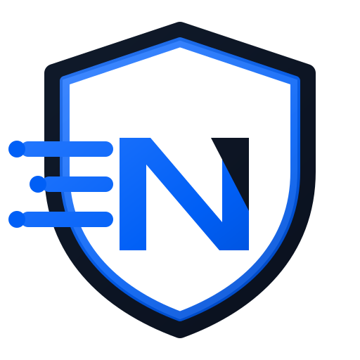

<p align="center">
  
  <br><br>
  <b>NexProxy</b><br>
  <i>Self-hosted reverse-proxy manager with a web UI — built for home labs and small teams.</i>
  <br><br>
  
  
</p>

NexProxy lets you forward domains, terminate SSL (free Let's Encrypt certificates), and expose your
self-hosted services — without needing to know Nginx or certbot. It runs as a single Docker image and
is managed entirely through a clean web interface.

- [Why NexProxy](#why-nexproxy)
- [Quick Setup](#quick-setup)
- [High Availability](#high-availability-enterprise)
- [Contributing](#contributing)
- [License](#license)

## Why NexProxy

NexProxy builds on the well-loved [Nginx Proxy Manager](https://github.com/NginxProxyManager/nginx-proxy-manager)
(MIT) and adds what real deployments keep asking for:

- **High Availability** — two nodes, automatic floating-IP failover. If one node dies, the other takes
  over the IP in seconds. No more single point of failure. *(Enterprise)*
- **True multi-tenancy** — real per-user isolation, so every user only sees and manages their own hosts. *(Enterprise)*
- **Fast fixes** — known, tested community fixes that sit unreleased upstream ship here immediately.
  Example: the [UDP stream packet-loss fix (#5000)](https://github.com/bonderaustria/nexproxy/issues/5000)
  that breaks TeamSpeak, Factorio and other UDP services is already included.

### Core features

- Beautiful, secure admin interface
- Create forwarding domains, redirections, streams and 404 hosts — no Nginx knowledge required
- Free SSL via Let's Encrypt, or bring your own certificates
- Access lists and HTTP authentication
- Advanced Nginx configuration for power users
- User management, permissions and audit log
- SQLite, MySQL/MariaDB **or PostgreSQL** backends

## Editions

The core is free and open source (MIT). Enterprise features live in
[`enterprise/`](enterprise/) and are free for private, non-commercial use — commercial
use requires a license.

**Running NexProxy in your homelab? Enterprise is free for you.** Private and
non-commercial setups get a licence key at no cost — just ask.

| Feature | Core (free) | Enterprise |
| --- | :---: | :---: |
| Reverse-proxy hosts, redirects, streams, 404 hosts | ✅ | ✅ |
| Free SSL (Let's Encrypt) + custom certificates | ✅ | ✅ |
| Access lists & HTTP authentication | ✅ | ✅ |
| Advanced Nginx configuration | ✅ | ✅ |
| User management, permissions & audit log | ✅ | ✅ |
| **High Availability** — floating-IP failover across nodes | — | ✅ |
| **True multi-tenancy** — per-user host isolation | — | ✅ |

## Quick Setup

1. [Install Docker](https://docs.docker.com/install/)
2. Create a `docker-compose.yml`:

```yml
services:
  app:
    image: 'ghcr.io/bonderaustria/nexproxy:latest'
    restart: unless-stopped
    ports:
      - '80:80'
      - '81:81'
      - '443:443'
    volumes:
      - ./data:/data
      - ./letsencrypt:/etc/letsencrypt
```

3. Start it:

```bash
docker compose up -d
```

4. Open the admin UI on port `81`: [http://127.0.0.1:81](http://127.0.0.1:81)

Default login: `admin@example.com` / `changeme` — change it immediately.

## High Availability (Enterprise)

An active-passive HA setup (two nodes, shared PostgreSQL, floating-IP failover via keepalived) lives in
[`enterprise/ha/`](enterprise/ha/). It keeps your reverse proxy reachable even when a node goes down.

> The `enterprise/` directory is source-available under a separate commercial license — free for private,
> non-commercial use; commercial use requires a license. See [`enterprise/LICENSE`](enterprise/LICENSE).

## Contributing

Pull requests are welcome against the `develop` branch. Stable releases are cut from `main`.

## Getting Support

- [Report a bug](https://github.com/bonderaustria/nexproxy/issues)
- [Discussions](https://github.com/bonderaustria/nexproxy/discussions)

## License

- The **core** of NexProxy is licensed under the [MIT License](LICENSE), and includes code from
  Nginx Proxy Manager (MIT) — its copyright notice is retained as required.
- The **`enterprise/`** directory is licensed separately for commercial use — see [`enterprise/LICENSE`](enterprise/LICENSE).
